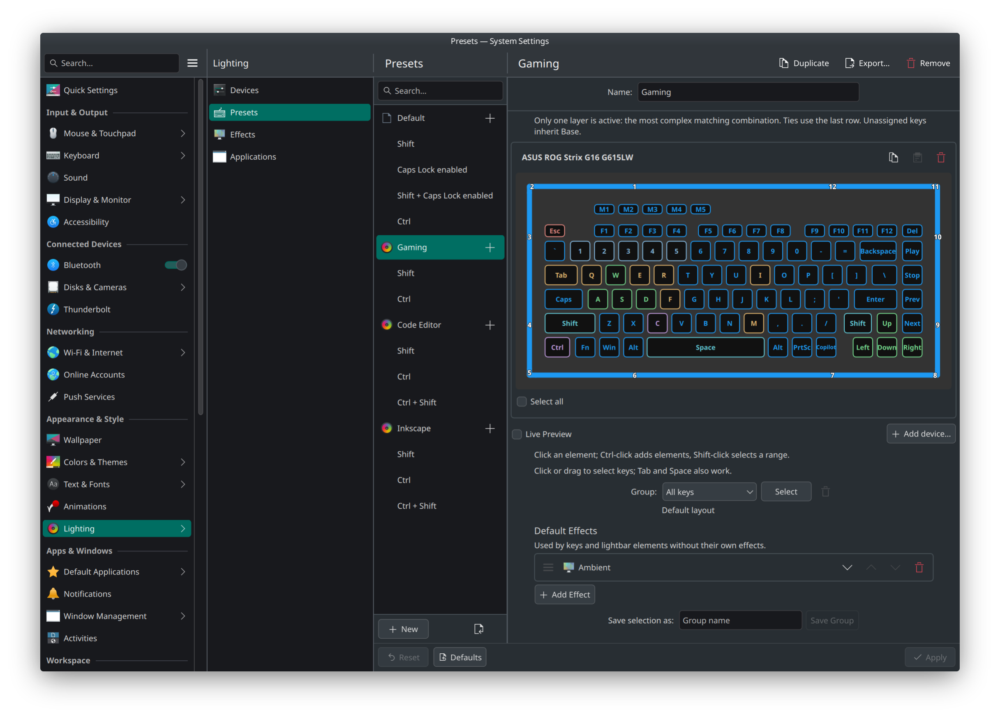

# klighting

Keyboard and lightbar lighting for KDE Plasma, with screen-driven Ambient colors,
Solid Color, notification effects, microphone mute indicators, key layers and
application presets. Multiple devices run through native Qt driver plugins.
The KDE settings entry is **Lighting**.

See [driver modules](src/drivers/) for supported hardware and module-specific requirements.



## Build

Linux with KDE Plasma. Current CMake minimums: **CMake 3.25, C++20, Qt 6.10,
ECM 6.26 and KWin 6.7**. Build against the installed KWin version.
Tested only on Manjaro (Arch-based), with KWin 6.7.5, Qt 6.11.2 and ECM 6.30.
Compatibility below these configured minimums has not been established.

<details>
<summary>Dependencies: Arch Linux / Manjaro</summary>

```sh
sudo pacman -S --needed base-devel cmake ninja pkgconf extra-cmake-modules \
  qt6-base qt6-declarative qt6-tools kwin kcoreaddons kconfig kcmutils \
  kguiaddons ki18n kservice kwindowsystem kirigami qqc2-desktop-style \
  libusb wayland libglvnd libepoxy libdrm vulkan-headers vulkan-icd-loader \
  dbus gettext
```

</details>

<details>
<summary>Dependencies: Ubuntu / Debian</summary>

Requires repositories meeting the minimums above (Ubuntu KDE packages are in
Universe). Stock [Ubuntu 26.04 LTS](https://packages.ubuntu.com/resolute/kwin-dev)
and [Debian 13](https://packages.debian.org/trixie/kwin-dev) have older KWin versions
and cannot build the project as configured.

```sh
sudo apt update
sudo apt install build-essential cmake ninja-build pkg-config gettext \
  extra-cmake-modules qt6-base-dev qt6-declarative-dev qt6-tools-dev \
  qt6-tools-dev-tools kwin-dev libkf6coreaddons-dev libkf6config-dev \
  libkf6kcmutils-dev libkf6guiaddons-dev libkf6i18n-dev libkf6service-dev \
  libkf6windowsystem-dev libkirigami-dev libusb-1.0-0-dev libwayland-dev \
  libgl-dev libegl-dev libepoxy-dev libdrm-dev libvulkan-dev dbus-daemon \
  qml6-module-qtquick qml6-module-qtquick-controls qml6-module-qtquick-layouts \
  qml6-module-qtquick-dialogs qml6-module-qtquick-window \
  qml6-module-qtquick-templates qml6-module-qtqml-workerscript \
  qml6-module-qt-labs-platform qml6-module-org-kde-kirigami \
  qml6-module-org-kde-kcmutils qml6-module-org-kde-desktop
```

</details>

<details>
<summary>Dependencies: Fedora</summary>

```sh
sudo dnf install gcc-c++ cmake ninja-build pkgconf-pkg-config gettext \
  extra-cmake-modules qt6-qtbase-devel qt6-qtdeclarative-devel qt6-qttools-devel \
  kwin-devel kf6-kcoreaddons-devel kf6-kconfig-devel kf6-kcmutils-devel \
  kf6-kguiaddons-devel kf6-ki18n-devel kf6-kservice-devel \
  kf6-kwindowsystem-devel kf6-kirigami-devel kf6-qqc2-desktop-style \
  libusb1-devel wayland-devel libglvnd-devel libepoxy-devel libdrm-devel \
  vulkan-headers vulkan-loader-devel dbus-daemon
```

</details>

For the service without KWin or its settings UI, add `-DBUILD_KWIN_EFFECT=OFF`.
See [Contributing](CONTRIBUTING.md#build-and-checks) for development checks.

The microphone observer uses `libpulse` with PulseAudio or PipeWire's
`pipewire-pulse` compatibility server. `KLIGHTING_PULSEAUDIO` accepts `AUTO`
(detect development files), `ON` (require them), or `OFF` (exclude the backend).
Use `-DKLIGHTING_PULSEAUDIO=ON` for distribution builds. An audio-enabled daemon
also needs `libpulse` at runtime.
Install the client development package before configuring an audio-enabled build:

| Distribution | Command |
| --- | --- |
| Arch Linux / Manjaro | `sudo pacman -S --needed libpulse` |
| Ubuntu / Debian | `sudo apt install libpulse-dev` |
| Fedora | `sudo dnf install pulseaudio-libs-devel` |

```sh
cmake -S . -B build -G Ninja -DCMAKE_BUILD_TYPE=RelWithDebInfo
cmake --build build --parallel
ctest --test-dir build --output-on-failure
```

## Install and run

For a new installation:

```sh
sudo cmake --install build
kcmshell6 kcm_ambientled
```

Apply starts `klightingd`; **Enable Ambient screen capture** adds screen colors. The same editor is available in KDE System
Settings under **Appearance & Style → Lighting**. For updates, staging and D-Bus
reload commands, see [installation](docs/install.md). Rebuild after KWin updates.

## Add a driver

Implement [`DeviceDriver`](src/device_driver.h) in `src/drivers/<vendor-model>/`
or an external Qt `.so` module. Drivers own discovery, capabilities, geometry and
hardware output; the host renders their layouts. Start with the
[driver guide and standalone CMake example](docs/device-drivers.md).

[Contributing](CONTRIBUTING.md) · [Architecture](docs/architecture.md) ·
[Settings](docs/settings.md) · [Security](SECURITY.md)

Author and maintainer: Evgenii Iulin, <mail@alltiptop.me>.

Code: [GPL-3.0-or-later](LICENSE).
Vendored skills retain their [original authorship and licenses](THIRD_PARTY.md).
